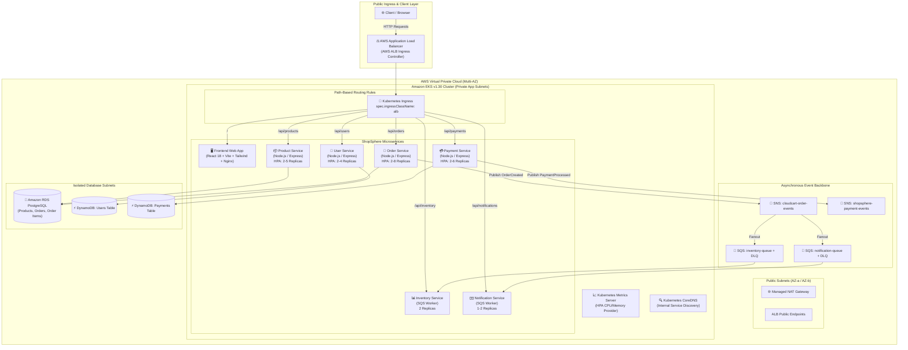

# 🛍️ ShopSphere — Production-Grade Containerized Microservices Platform on AWS

[](https://github.com/dineTH2003-dev/cloudcart-aws-microservices/actions/workflows/ci.yml)
[](https://github.com/dineTH2003-dev/cloudcart-aws-microservices/actions/workflows/terraform.yml)
[](https://kubernetes.io/)
[](https://aws.amazon.com/eks/)
[](https://aws.amazon.com/elasticloadbalancing/)
[](https://www.terraform.io/)
[](https://react.dev/)
[](LICENSE)

An enterprise-ready, containerized tech e-commerce microservices platform architected on **Amazon Web Services (AWS)** using **Amazon EKS (Elastic Kubernetes Service)**, **Docker**, **AWS Application Load Balancer**, **Terraform**, **PostgreSQL (RDS)**, **DynamoDB**, **SNS/SQS event-driven decoupling**, and **React 18 + Vite**.

Built as a premier capstone project fulfilling every requirement of the advanced **Containerized Microservices Architecture** curriculum (Dockerfiles, ECR, EKS, K8s manifests, VPC networking, Service Discovery, HPA auto-scaling, ALB load balancing, and metrics monitoring).

---

## 🌐 Live Cloud Deployment

* **Public Web Storefront (AWS ALB)**: [http://k8s-cloudcar-cloudcar-352b03f38d-719233025.us-east-1.elb.amazonaws.com](http://k8s-cloudcar-cloudcar-352b03f38d-719233025.us-east-1.elb.amazonaws.com)
* **Local One-Click Preview Bridge**: Run `./scripts/preview-live-eks.sh` → [http://localhost:3001](http://localhost:3001)

---

## 🏛️ System Architecture



---

## 📦 Microservices Breakdown

| Microservice | Role | Tech Stack | Storage / Messaging | Port | Key Endpoints |
| :--- | :--- | :--- | :--- | :---: | :--- |
| **Frontend** | Modern React SPA Storefront, category filters, cart drawer, live event stream | React 18, Vite, Tailwind CSS, Nginx | Static Nginx Alpine | `80` / `3001` | `/` (Interactive Storefront) |
| **Product Service** | Tech gadget catalog, category querying, stock tracking | Node.js, Express, TypeScript | Amazon RDS (PostgreSQL) | `8001` | `GET /api/products`<br/>`GET /api/products/:id` |
| **User Service** | User registration, authentication, address profile | Node.js, Express, TypeScript | Amazon DynamoDB | `8002` | `POST /api/users/register`<br/>`POST /api/users/login`<br/>`GET /api/users/:id` |
| **Order Service** | Checkout orchestration, order lifecycle, SNS publisher | Node.js, Express, TypeScript | Amazon RDS + Amazon SNS | `8003` | `POST /api/orders`<br/>`GET /api/orders/:id`<br/>`GET /api/orders` |
| **Payment Service** | Payment gateway simulation, card verification, DynamoDB ledger | Node.js, Express, TypeScript | Amazon DynamoDB + Amazon SNS | `8006` | `POST /api/payments/process`<br/>`GET /api/payments/:id`<br/>`GET /api/payments/order/:orderId` |
| **Inventory Service** | Event-driven stock reservation, atomic deduction, auto-rejection | Node.js, TypeScript Worker | Amazon RDS + Amazon SQS | `8004` | Consumes `inventory-queue`<br/>`GET /api/inventory/:productId` |
| **Notification Service** | Customer email/SMS dispatch simulator, audit history | Node.js, TypeScript Worker | Amazon SQS | `8005` | Consumes `notification-queue`<br/>`GET /api/notifications` |

---

## ⚡ Asynchronous Event-Driven Architecture

Orders follow an asynchronous event-driven pattern with polyglot persistence to guarantee extreme resilience and zero blocking operations during high-traffic sales:

```text
User Checkout (React UI)
     │
     ▼
[Order Service] ───(Persists order PENDING in PostgreSQL RDS)
     │
     ▼
[Payment Service] ──(Simulates gateway; persists in DynamoDB)
     │
     ├── If APPROVED ──► [Amazon SNS Topic: cloudcart-order-events]
     │                         │
     │                         ├─── Fanout ──► [Amazon SQS: inventory-queue]
     │                         │                     │
     │                         │                     ▼
     │                         │               [Inventory Service]
     │                         │               Checks stock atomically in RDS:
     │                         │               • If available: deducts stock & marks CONFIRMED
     │                         │               • If unavailable: marks CANCELLED_OUT_OF_STOCK
     │                         │
     │                         └─── Fanout ──► [Amazon SQS: notification-queue]
     │                                               │
     │                                               ▼
     │                                         [Notification Service]
     │                                         Dispatches mock customer email
     │
     └── If DECLINED ──► Transaction halted, customer notified immediately
```

### Fault Tolerance & Dead-Letter Queues (DLQ)
Both SQS queues feature attached **Dead-Letter Queues (`-dlq`)** configured with a redrive policy (`maxReceiveCount = 3`). If a poisoned or malformed message fails processing 3 consecutive times, SQS quarantines it into the DLQ without blocking queue throughput.

---

## 🚀 Quickstart & Local Development

Run the entire platform locally with zero external cloud dependencies using **Docker Compose** and **LocalStack**:

```bash
# Clone the repository
git clone https://github.com/dineTH2003-dev/cloudcart-aws-microservices.git
cd cloudcart-aws-microservices

# Build and start all 8 containers locally
make up
```

Access locally:
* **Storefront Web UI**: [http://localhost:3001](http://localhost:3001)
* **Product Catalog API**: [http://localhost:8001/api/products](http://localhost:8001/api/products)
* **Payment Service**: [http://localhost:8006/healthz](http://localhost:8006/healthz)
* **LocalStack Gateway**: [http://localhost:4566](http://localhost:4566)

---

## ☁️ Deploying to Amazon EKS & AWS

### 1. Provision Infrastructure with Terraform
```bash
cd infrastructure/terraform/environments/dev

terraform init
terraform plan
terraform apply -auto-approve
```

### 2. Build & Deploy Microservices
```bash
./scripts/deploy-eks.sh
```

### 3. Live Browser Preview
```bash
./scripts/preview-live-eks.sh
```

---

## 💥 Chaos & Failure Engineering

Prove that the platform survives operational failures without dropping customer orders:

### 1. Pod Crash & Self-Healing Test
```bash
./tests/chaos/chaos-pod-kill.sh
```
*Force terminates a live microservice pod; verifies Kubernetes ReplicaSet provisions a new healthy replica without dropping in-flight traffic.*

### 2. Traffic Spike & HPA Auto-Scaling Test
```bash
./tests/chaos/chaos-load-spike.sh
```
*Simulates concurrent requests; verifies CPU metrics trigger Horizontal Pod Autoscaler scaling up replicas dynamically.*

### 3. Poison-Pill & Dead-Letter Queue (DLQ) Test
```bash
./tests/chaos/chaos-dlq-test.sh
```
*Injects unparseable JSON into the SQS queue; proves message is retried 3 times and quarantined in DLQ without crashing the worker.*

---

## 🔐 Security & Best Practices

1. **Non-Root Containers**: All Dockerfiles specify `USER node` (`UID 1000`) and disallow privilege escalation.
2. **IAM Roles for Service Accounts (IRSA)**: EKS pods authenticate to DynamoDB, SNS, SQS, and ALB controller via temporary STS tokens using the cluster OIDC provider — zero long-lived AWS keys in containers.
3. **Network Isolation**: Worker nodes and RDS PostgreSQL live strictly inside private subnets without public IPs.
4. **Multi-Stage Docker Builds**: Lean production images with pruned devDependencies and minimal attack surface.

---

## 💼 Architectural Talking Points for Interviews

* **Why Amazon EKS over Amazon ECS?**
  * EKS enables enterprise multi-cloud portability, declarative GitOps workflows, rich ecosystem tooling (HPA, Metrics Server, Helm, Kustomize), and fine-grained scheduling.
* **Why Polyglot Persistence (RDS vs DynamoDB)?**
  * Product catalogs and order headers require transactional consistency, complex filtering, and ACID guarantees best suited for PostgreSQL (RDS). Users, cart sessions, and payment audit logs demand single-digit millisecond latency, key-value lookups, and auto-scaling writes best suited for DynamoDB.
* **How are cascade failures prevented during traffic surges?**
  * Asynchronous decoupling via SNS fan-out into buffered SQS queues ensures downstream inventory and notification services process orders at their own rate without degrading frontend checkout responsiveness.

---

## 📄 License
Distributed under the MIT License. Built with ❤️ for cloud architects and DevOps engineers.
