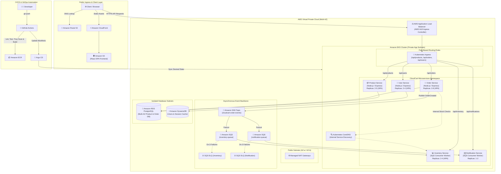

# 🛒 CloudCart — Production-Grade Microservices Platform on AWS

[](https://github.com/dineTH2003-dev/cloudcart-aws-microservices/actions/workflows/ci.yml)
[](https://github.com/dineTH2003-dev/cloudcart-aws-microservices/actions/workflows/terraform.yml)
[](https://kubernetes.io/)
[](https://aws.amazon.com/eks/)
[](https://www.terraform.io/)
[](https://argoproj.github.io/cd/)
[](https://nodejs.org/)
[](LICENSE)

An enterprise-ready, containerized e-commerce microservices platform architected on **Amazon Web Services (AWS)** using **Amazon EKS (Elastic Kubernetes Service)**, **Docker**, **Terraform**, **GitHub Actions**, and **Argo CD**.

Built as the capstone project demonstrating modern **Cloud Architecture, DevOps, SRE, and Container Orchestration** best practices.

---

## 🏛️ System Architecture



---

## 📦 Microservices Breakdown

| Microservice | Role | Tech Stack | Storage / Messaging | Port | Key Endpoints |
| :--- | :--- | :--- | :--- | :---: | :--- |
| **Product Service** | Catalog browsing, category filtering, product creation | Node.js, Express, TypeScript | Amazon RDS (PostgreSQL) | `8001` | `GET /api/products`<br/>`GET /api/products/:id`<br/>`POST /api/products` |
| **User Service** | User registration, authentication, address profile | Node.js, Express, TypeScript | Amazon DynamoDB | `8002` | `POST /api/users/register`<br/>`POST /api/users/login`<br/>`GET /api/users/:id` |
| **Order Service** | Checkout orchestration, order lifecycle | Node.js, Express, TypeScript | Amazon RDS + Amazon SNS | `8003` | `POST /api/orders`<br/>`GET /api/orders/:id`<br/>`GET /api/orders/user/:userId` |
| **Inventory Service** | Event-driven stock reservation, auto-rejection | Node.js, TypeScript Worker | Amazon RDS + Amazon SQS | `8004` | Consumes `inventory-queue`<br/>`GET /api/inventory/:productId` |
| **Notification Service** | Mock customer email/SMS dispatch, audit trail | Node.js, TypeScript Worker | Amazon SQS | `8005` | Consumes `notification-queue`<br/>`GET /api/notifications` |
| **Frontend** | Interactive shopping cart & live checkout demo UI | HTML5, Tailwind CSS, JS, Nginx | Static Nginx / S3 | `3000` | `/` (Interactive Storefront) |

---

## ⚡ Asynchronous Event-Driven Decoupling

Orders are fulfilled using an **asynchronous event-driven architectural pattern** to prevent cascade failures and blocking HTTP requests during checkout:

```text
User Checkout
     │
     ▼
[Order Service] ───(Persists Order PENDING)
     │
     ▼
[Amazon SNS Topic: cloudcart-order-events]
     │
     ├─── Fanout ──► [Amazon SQS: cloudcart-inventory-queue]
     │                     │
     │                     ▼
     │               [Inventory Service]
     │               Checks stock atomically in PostgreSQL:
     │               • If in stock: reserves stock & confirms order
     │               • If out of stock: cancels order
     │
     └─── Fanout ──► [Amazon SQS: cloudcart-notification-queue]
                           │
                           ▼
                     [Notification Service]
                     Dispatches customer email/SMS confirmation
```

### Fault Tolerance & Dead-Letter Queues (DLQ)
Both SQS queues feature attached **Dead-Letter Queues (`-dlq`)** configured with a redrive policy:
* `maxReceiveCount = 3`: If a poisoned or malformed message causes processing failures 3 times consecutively, SQS isolates it into the DLQ without blocking queue throughput.

---

## 🛠️ Repository Layout

```text
cloudcart-aws-microservices/
├── .github/
│   └── workflows/
│       ├── ci.yml                 # Lint, build, test, Docker build & Trivy scan
│       ├── cd.yml                 # OIDC AWS auth, build & push to ECR, GitOps release
│       └── terraform.yml          # Terraform format, init, and validate
├── services/
│   ├── product-service/           # Product Catalog microservice
│   ├── user-service/              # User Profile & Auth microservice
│   ├── order-service/             # Order Checkout & SNS Publisher microservice
│   ├── inventory-service/         # SQS Consumer Stock Manager microservice
│   └── notification-service/      # SQS Consumer Notification microservice
├── frontend/                      # Interactive Web UI & Nginx container
├── docker-compose.yml             # Full local stack (Postgres + LocalStack + 5 Services)
├── infrastructure/
│   └── terraform/
│       ├── environments/dev/      # Root dev environment wiring all modules
│       └── modules/
│           ├── vpc/               # Multi-AZ VPC, subnets, NAT, IGW
│           ├── ecr/               # 6 Private ECR repos with lifecycle rules
│           ├── rds/               # PostgreSQL db.t4g.micro instance
│           ├── dynamodb/          # DynamoDB table with KMS and PITR
│           ├── messaging/         # SNS Topic, SQS Queues, DLQs, Policies
│           └── eks/               # EKS Cluster, Node Group, OIDC IRSA, Addons
├── kubernetes/
│   ├── base/
│   │   ├── kustomization.yaml     # Root Kustomize bundle
│   │   ├── namespace.yaml         # Namespace: cloudcart
│   │   ├── ingress.yaml           # AWS ALB Ingress Controller rules
│   │   ├── product/               # Deployment, Service, ConfigMap, HPA
│   │   ├── user/
│   │   ├── order/
│   │   ├── inventory/
│   │   ├── notification/
│   │   └── frontend/
│   └── argocd/
│       └── application.yaml       # Declarative Argo CD Application CRD
├── scripts/
│   ├── init-db.sql                # PostgreSQL schema & catalog seed script
│   └── init-localstack.sh         # LocalStack SQS/SNS/DynamoDB bootstrap script
├── tests/
│   ├── integration/
│   │   └── test-checkout.sh       # E2E integration test script
│   └── chaos/
│       ├── chaos-pod-kill.sh      # Pod crash self-healing test
│       ├── chaos-load-spike.sh    # Traffic burst & HPA auto-scaling test
│       └── chaos-dlq-test.sh      # Poison-pill message & DLQ isolation test
├── Makefile                       # Developer CLI shortcuts
├── .env.example                   # Environment variable template
└── README.md
```

---

## 🚀 Quickstart & Local Development

Run the entire platform locally with zero external cloud dependencies using **Docker Compose** and **LocalStack**:

### 1. Start the Platform
```bash
# Clone the repository
git clone https://github.com/dineTH2003-dev/cloudcart-aws-microservices.git
cd cloudcart-aws-microservices

# Build and start all 8 containers
make up
```

### 2. Access the Application
* **Storefront Web UI**: [http://localhost:3001](http://localhost:3001)
* **Product Service**: [http://localhost:8001/api/products](http://localhost:8001/api/products)
* **User Service**: [http://localhost:8002/healthz](http://localhost:8002/healthz)
* **Order Service**: [http://localhost:8003/healthz](http://localhost:8003/healthz)
* **LocalStack AWS Gateway**: [http://localhost:4566](http://localhost:4566)

### 3. Run Automated Integration Tests
```bash
make test
```
The test suite validates:
1. All 5 `/healthz` endpoints respond `200 OK`.
2. Initial stock is queried from `product-service`.
3. User profile is verified in DynamoDB.
4. An order is submitted to `order-service` with initial status `PENDING`.
5. Event is published to SNS and consumed by `inventory-service` via SQS.
6. Stock is deducted and order transitions to `CONFIRMED`.
7. `notification-service` receives event and dispatches mock customer email.

---

## 💥 Chaos & Failure Engineering

Prove that the platform survives operational failures without dropping customer orders:

### 1. Pod Crash & Self-Healing Test
```bash
./tests/chaos/chaos-pod-kill.sh
```
*Force terminates a live microservice pod; verifies Kubernetes ReplicaSet provisions a new healthy replica without dropping in-flight traffic.*

### 2. Traffic Spike & HPA Auto-Scaling Test
```bash
./tests/chaos/chaos-load-spike.sh
```
*Simulates 500 concurrent requests; verifies CPU metrics trigger Horizontal Pod Autoscaler from 2 to 4+ replicas.*

### 3. Poison-Pill & Dead-Letter Queue (DLQ) Test
```bash
./tests/chaos/chaos-dlq-test.sh
```
*Injects unparseable JSON into the SQS queue; proves message is retried 3 times and quarantined in DLQ without crashing the worker.*

---

## ☁️ Cloud Deployment with Terraform & EKS

Deploy the entire production infrastructure into your AWS account:

```bash
cd infrastructure/terraform/environments/dev

# Copy example variables
cp terraform.tfvars.example terraform.tfvars

# Initialize Terraform modules and download AWS providers
terraform init

# Review execution plan
terraform plan

# Provision VPC, EKS, RDS, DynamoDB, SNS, and SQS
terraform apply -auto-approve
```

### Configure kubectl for EKS
```bash
aws eks update-kubeconfig --region us-east-1 --name cloudcart-eks-dev
```

### Deploy with Kustomize or Argo CD
```bash
# Direct deployment via Kustomize
kubectl apply -k kubernetes/base

# Or via GitOps with Argo CD
kubectl apply -f kubernetes/argocd/application.yaml
```

---

## 🔐 Security & Best Practices

1. **Non-Root Containers**: All Dockerfiles specify `USER node` (`UID 1000`) and disallow privilege escalation.
2. **IAM Roles for Service Accounts (IRSA)**: EKS pods authenticate to DynamoDB, SNS, and SQS via temporary STS tokens using the cluster OIDC provider — zero long-lived AWS keys in containers.
3. **Network Isolation**: Worker nodes and RDS PostgreSQL live strictly inside private subnets without public IPs.
4. **Automated Vulnerability Scanning**: Aqua Security Trivy scans all container images during CI for CVEs.

---

## 💼 Interview Talking Points

* **Why Amazon EKS over Amazon ECS?**
  * EKS enables enterprise multi-cloud portability, declarative GitOps workflows with Argo CD, Kubernetes ecosystem tooling (Kustomize, Helm, HPA), and fine-grained resource scheduling.
* **Why Polyglot Persistence (RDS vs DynamoDB)?**
  * Product catalogs and order headers have structured schemas, foreign keys, and ACID transactional requirements best suited for PostgreSQL (RDS). Users and cart sessions demand ultra-low latency, key-value lookups, and auto-scaling writes best suited for DynamoDB.
* **How are cascade failures prevented during traffic surges?**
  * Asynchronous decoupling via SNS fan-out into buffered SQS queues ensures downstream inventory and notification services process orders at their own rate without degrading frontend checkout responsiveness.

---

## 📄 License
Distributed under the MIT License. Built with ❤️ for cloud architects and DevOps engineers.
